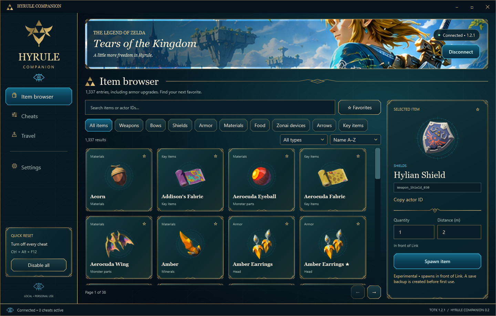
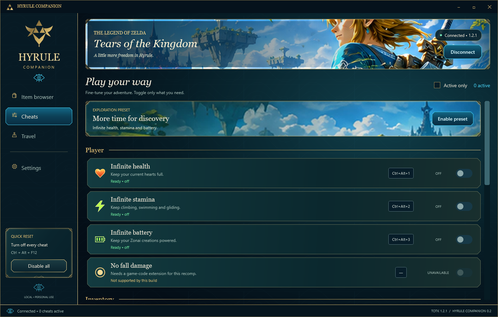
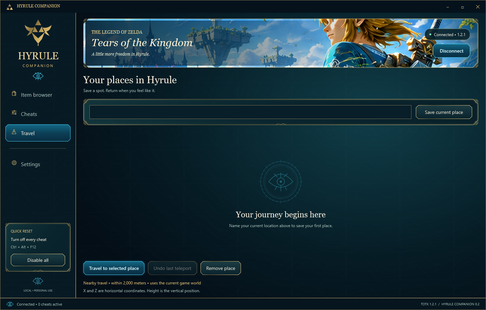
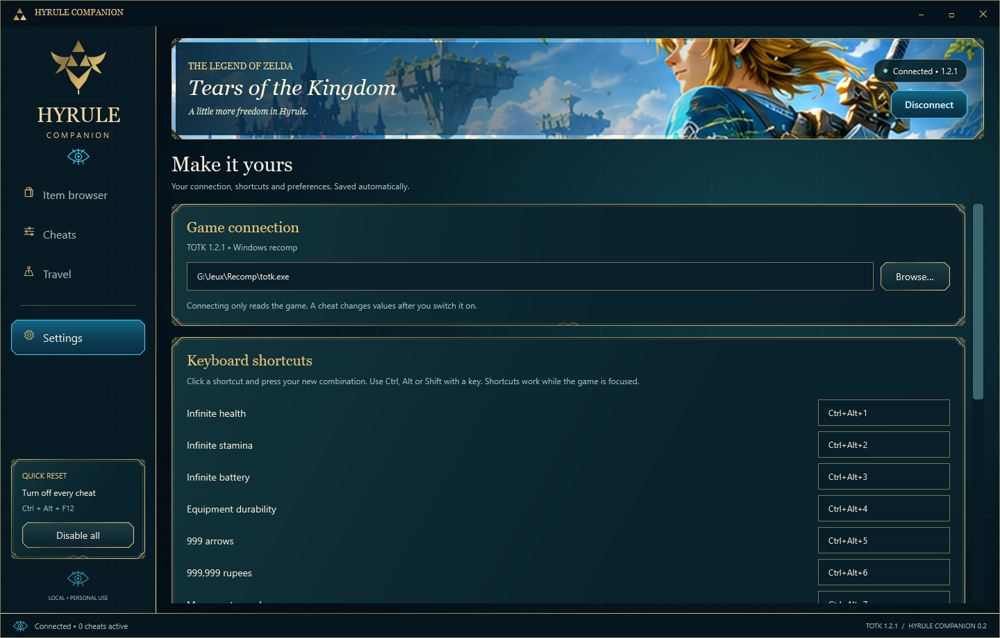

# Hyrule Companion

A native Windows companion for **The Legend of Zelda: Tears of the Kingdom PC recomp**, with a Zelda-inspired navy, gold and turquoise interface.



## Download and run

[**Download Hyrule Companion v0.2.0 for Windows**](https://github.com/Guizmo12/totk_recomp_Cheats/raw/refs/heads/main/downloads/HyruleCompanion-v0.2.0.zip)

1. Extract the ZIP into a writable folder. Keep the `assets` folder beside `HyruleCompanion.exe`.
2. Install the [.NET 8 Desktop Runtime for Windows](https://dotnet.microsoft.com/en-us/download/dotnet/8.0) if it is not already installed.
3. Open `HyruleCompanion.exe`. Choose your `totk.exe` in **Settings → Browse** if the saved/default path is different.
4. Start the game, load your save, then click **Connect to game**. Every cheat starts off.

The supported game is **TOTK 1.2.1, recomp release 0.1.1+701bd62**. Native item spawning and travel validate the exact executable before attaching. The game, ROM, keys and saves are not included. The ZIP's SHA-256 is in [downloads/SHA256SUMS.txt](downloads/SHA256SUMS.txt).

## Four working tabs

- **Item browser:** 1,337 real entries with pictures; name/actor-ID search; category/type filters; favorites; recent selections; pagination; editable quantity and spawn distance.
- **Cheats:** health, stamina, battery, equipped durability, arrows, rupees, movement speed and experimental high jump; individual switches and an exploration preset.
- **Travel:** save named places, travel nearby (within 2,000 meters), undo the last teleport, and remove places.
- **Settings:** game path, customizable shortcuts, always-on-top, return-to-game behavior, reduced interface animations and connection reports.

Spawning accepts **1–25 pickups** at **1–10 meters** in front of Link. **Arrows ×5** and **Arrows ×10** are separate entries; quantity counts bundles. Inventory-only entries without a world actor remain searchable with spawning unavailable. A save backup is created before the first native spawn/travel action.

### Default shortcuts

| Action | Shortcut |
| --- | --- |
| Health / stamina / battery | Ctrl + Alt + 1 / 2 / 3 |
| Durability / arrows / rupees | Ctrl + Alt + 4 / 5 / 6 |
| Movement speed / high jump | Ctrl + Alt + 7 / 8 |
| Spawn selected item | Ctrl + Alt + S |
| Disable every cheat | Ctrl + Alt + F12 |
| Search items in the companion | Ctrl + F |

Cheat/spawn shortcuts apply while the game is focused. The emergency disable shortcut also works globally. Personal preferences are saved locally in `user-settings.json`; backups remain in the application's `backups` folder.

## Build from source

Requirements: Windows, the **.NET 8 SDK or newer**, and the .NET 8 Desktop Runtime.

```powershell
.\build.ps1
```

Run `artifacts/HyruleCompanion/HyruleCompanion.exe`. The build script copies the item catalog and its images into the output folder. An optional output path can be passed with `-OutputDirectory`.

Run the existing logic/native-callback checks:

```powershell
dotnet run --project Tests/Tests.csproj -c Release
```

The 20 checks cover filtering, shortcut parsing, pointer validation, refusal of invalid writes, speed restoration, jump scaling, arrow aliases/bundles and preservation of guest CPU state. Test-process/fake-memory checks do not substitute for live gameplay testing.

### Project layout

```text
App/                     Existing WPF application and game integration
  Themes/                Shared visual tokens, control styles and ornaments
  Presentation/          Vector frames, image cache and responsive layout
  Resources/             Embedded illustration and SVG resources
Tests/                   Logic and native-callback checks
assets/                  Complete item catalog and referenced images
docs/screenshots/        Captures of the four actual screens
downloads/               Ready-to-run application ZIP and checksum
```

`--connect` connects read-only at startup. `--visual-review --connect` checks the interface and exports captures without activating cheats. `--live-check` briefly changes speed and position in the running game; see [verification details](VERIFICATION.md) before using it.

## Verification and current limits

The visual edition was built and checked across all four screens at 1440×920, 1600×900, 1920×1080 and 1120×720, with additional WPF rendering at 125%. See [the redesign report](REFONTE.md) and [earlier gameplay verification](VERIFICATION.md).

**No fall damage is unavailable on this game build. High jump and actor spawning remain experimental.** The graphic redesign preserves the existing game integration; it does not claim every item or gameplay interaction has been tested. The repository excludes personal settings, backups and local process reports.

<details>
<summary>More screenshots</summary>

### Cheats


### Travel


### Settings


</details>

## Credits

Independent companion for the [TOTK PC recomp](https://github.com/valentderah/totk-pc-recomp). Item catalog and icon credits, game research references and graphic-resource attribution are listed in [SOURCES.md](SOURCES.md). The included catalog components retain their [MIT license notice](CATALOG-LICENSE.txt). Original game artwork belongs to Nintendo. This project is not affiliated with Nintendo or Wand.
